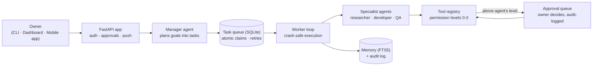

# ARTHUR — Autonomous Reasoning & Task Handling Utility Runtime

**A personal AI agent platform that plans, delegates and executes work like a small team — while the owner keeps final control.** You describe a goal in plain language; ARTHUR's manager agent breaks it into tasks, specialist agents (researcher, developer, QA) execute them through a permissioned tool registry, risky actions stop for one-tap owner approval, and everything is written to a persistent memory and audit log.

**Designed, built and owned by Mohammed Abdul Farhan** — sole owner and admin. Product and ownership record: [APP_DOSSIER.md](APP_DOSSIER.md).

### Why it stands out
- 🧠 **Multi-agent orchestration** — a manager agent plans goals into a task queue; specialist agents claim and execute tasks atomically, with crash-safe retries and checkpointing
- ✋ **Human-in-control by design** — a 4-level permission system (READ → HIGH RISK); anything above an agent's level becomes a pending approval instead of running — approvals are one-tap on mobile, always audit-logged
- 📱 **Real mobile app** — Expo / React Native / TypeScript client (Chat, Dashboard, one-tap Approvals, Projects/Tasks) with Expo Push notifications; one codebase for iOS + Android
- 🗄️ **Persistent memory** — SQLite + FTS5 full-text memory and a complete activity audit trail across sessions
- 🔐 **Security-first** — single owner/admin (no backdoors, no second admin), encrypted secrets at rest, bcrypt + rate-limited auth, log scrubbing, egress allowlist, file tools jailed to the data directory
- ▶️ **Runs with zero setup** — `DEMO_MODE` works with no API keys and no external services (SQLite only), so anyone can clone and try it in minutes

### Business impact
- Turns one person's instructions into coordinated multi-step execution — research, code and QA in one pipeline — with the owner approving only the decisions that matter
- The approval gate + audit log make agent work **reviewable and accountable**, the two properties missing from most autonomous-agent demos
- Ships as a complete product surface — CLI, web dashboard, REST API and mobile app — not a notebook experiment

### Testing & verification
- **Auth lifecycle smoke test — 8/8 checks passed** (real FastAPI server, throwaway DB: unauthenticated 401s, wrong-password rejection, token issue/expiry, logout invalidation) — `tests/test_auth_api.py`, verified 7 Nov 2026
- Security model (permission levels, approvals, file jail, egress allowlist) documented under *Security notes* below and in [APP_DOSSIER.md](APP_DOSSIER.md)

### Tech stack
| Layer | Technology |
|---|---|
| Agent core | Python · manager/worker loop · SQLite task queue (atomic claims, backoff, crash recovery) |
| API | FastAPI · REST · signed auth (bcrypt, rate limits) · Expo Push notifications |
| Memory | SQLite FTS5 full-text store · activity audit log |
| Web | Single-file live dashboard (projects, agents, tasks, approvals, chat) |
| Mobile | Expo · React Native · TypeScript (iOS + Android, one codebase) |
| Packaging | Docker Compose (API + worker) · roadmap hooks for Postgres/Redis |

### Architecture


*Full engineering manual below — quickstart, ASCII architecture, security model, and the 11-phase roadmap.*

---

# ARTHUR — Autonomous Reasoning & Task Handling Utility Runtime (MVP)

ARTHUR is a personal/team AI agent system: you describe a goal in plain
language, the **manager** agent plans it into tasks, specialist agents
(**researcher**, **developer**, **qa**, …) execute them through a permissioned
tool registry, and you watch it all on a live dashboard. It runs today in
`DEMO_MODE` — no API keys, no external services, SQLite only.

## Quickstart

```bash
cd ~/workspace/arthur-ai
python3 -m venv .venv && .venv/bin/pip install -r requirements.txt

# Interactive CLI (first run prompts for the owner name):
DEMO_MODE=true .venv/bin/python backend/main.py
```

At the `ARTHUR>` prompt, try the built-in demo goal:

```
ARTHUR> build a tiny markdown notes CLI
```

The manager will plan 3 tasks (research → implement → smoke test), the
background worker will execute them, and you'll get a final report with a
completion checklist. Artifacts land in `./data/projects/tiny-markdown-notes-cli/`.

Useful REPL commands: `/projects`, `/tasks [project_id]`, `/agents`,
`/approvals`, `/approve <id>`, `/quit`.

### Web API + dashboard

```bash
DEMO_MODE=true uvicorn backend.api.server:app --host 0.0.0.0 --port 8000
# open http://localhost:8000  — live dashboard (projects, agents, tasks,
# approvals, activity log, chat). Chat POSTs to /api/chat.
```

### Docker

```bash
docker compose up            # api (port 8000) + worker
# docker compose --profile phase5 up   # Phase 5: postgres + redis (commented)
```

## Architecture

```
                    +------------------+
                    |   CLI / REPL     |   backend/main.py
                    |   Dashboard UI   |   frontend/dashboard.html
                    +--------+---------+
                             |  HTTP /api/*
                    +--------v---------+
                    |   FastAPI app    |   backend/api/server.py
                    +--------+---------+
                             |
        +--------------------+--------------------+
        |                    |                    |
+-------v-------+   +--------v--------+   +-------v--------+
| Manager agent |   |  Task queue     |   |  Tool registry |
| plans goals,  |   |  SQLite-backed  |   |  permission    |
| verifies      |   |  states:        |   |  levels 0-3,   |
| completion    |   |  CREATED..      |   |  approvals,    |
|               |   |  COMPLETED      |   |  audit log     |
+-------+-------+   +--------+--------+   +-------+--------+
        |                    |                    |
+-------v-------+   +--------v--------+   +-------v--------+
| Worker loop   |   |  Scheduler      |   |  Specialist    |
| claim_next(), |   |  manager tick   |   |  agents:       |
| crash-safe    |   |  every 10s      |   |  researcher/   |
| retries       |   |                 |   |  developer/qa  |
+---------------+   +-----------------+   +----------------+
        |
+-------v--------+
| Memory (FTS5)  |   backend/memory/store.py
| Activity audit |
| Push notify    |   backend/api/notify.py (Expo)
+----------------+
```

Data lives under `ARTHUR_HOME/data` (override with `ARTHUR_DB_PATH`);
file tools are jailed to `DATA_DIR`.

## What's real vs stubbed (MVP)

Real: SQLite schema + seeds, atomic task claiming, retries with backoff,
crash recovery (`recover_running`), checkpointing, tool registry with
permission gating + approval queue + audit log, manager planning (rule-based
in DEMO_MODE), notes-CLI demo template, CLI first-run owner setup, FastAPI
+ single-file dashboard, Expo push sender (never raises).

Stubbed / Phase-gated: real LLM planning (needs `DEMO_MODE=false` +
`ARTHUR_LLM_*`), `browser` agent (Phase 8), `analyst` agent (Phase 4),
Postgres/Redis/pgvector (Phase 5, commented in docker-compose).

## 11-phase roadmap

1. **MVP** — queue, agents, CLI/API/dashboard, approvals (this repo).
2. **Real LLM planning** — JSON plans from `ARTHUR_LLM_*`, replanning on failure.
3. **Approvals UX** — richer dashboard approvals, expiry, delegation.
4. **Analyst agent** — data crunching, charts.
5. **Postgres/Redis/pgvector** — scale + vector memory.
6. **Teams & multi-user** — roles beyond owner/admin, per-team queues.
7. **Voice interface** — spoken goals and status.
8. **Browser agent** — real web navigation with its own approval gates.
9. **Mobile app** — Expo/React Native client, push via `/api/push/register`.
10. **Skills marketplace** — installable tool packs with permission manifests.
11. **Autonomous ops** — scheduled goals, self-healing infra, full audit export.

## Security notes

- **Permission levels**: 0 READ (web_search, fetch_url, read/list files),
  1 LOW RISK (write/edit files, shell, python), 2 EXTERNAL ACTIONS,
  3 HIGH RISK. Agents declare a level; tools declare a required level.
- **Approvals**: any agent requesting a tool above its level creates a
  `pending` approval instead of running it. Admin privilege resolves
  approvals — it never skips them, and resolution is audit-logged.
- **File jail**: file tools resolve every path under `DATA_DIR`; escapes are
  refused. Shell cwd must stay under `ARTHUR_HOME`; destructive patterns
  (`rm -rf /`, `mkfs`, fork bombs) are refused.
- **Audit log**: every tool call lands in `activity_logs` with agent, args,
  ok/error — including denied and approval-gated calls.
- **Owner/admin**: first run creates the Owner account (`is_admin=1`) via an
  interactive prompt (or `ARTHUR_OWNER_NAME` seed). Only admins resolve
  approvals or manage users. `backend/database/db.py` never imports other
  backend modules — no circular imports.

### Sole-admin guarantee

- **Exactly one admin.** The owner account is the sole admin. There are no
  built-in, default, backdoor, "system", "assistant", or agent admin
  accounts — agents live in the `agents` table, never in `users`, and the
  seed creates only the owner. Muse is not an admin and has no privileged
  access built in.
- **No second admin, no self-promotion.** `create_user(..., is_admin=True)`
  works only when no admin exists yet (first-run bootstrap); afterwards it
  refuses. `update_user_role()` requires the actor to be the existing admin,
  refuses to grant admin to anyone but the current sole admin, and refuses
  to demote the owner.
- **No autonomous self-modification.** Agents (including the Manager)
  cannot modify ARTHUR's own codebase, configuration, permissions, roles,
  or user accounts on their own. The ToolRegistry classifies as **LEVEL 3**
  (owner approval always, no auto-approve path — no agent is above level 2):
  file writes outside `DATA_DIR/projects/`; shell/python touching the
  auth/role/permission tables (`users`, `tool_permissions`), role helpers,
  the `arthur-ai` source tree, or secrets (`.env`, API keys). The file and
  shell jails stay as defense-in-depth behind this gate.
- **Full audit.** Every role change, permission change, and approval
  resolution is written to `activity_logs` with actor, timestamp, and the
  old→new diff.

### Security hardening (beyond the MVP baseline)

- **Encrypted secrets at rest.** API keys/tokens live Fernet-encrypted
  (`backend/security/secrets.py`, key from `ARTHUR_SECRET_KEY` or a
  600-permission key file). Secrets are **never** written to logs, chat
  history, or error messages — a scrubber redacts key-like values
  (`sk-…`, `ExponentPushToken[…]`, `api_key=…`, `Bearer …`, `ARTHUR_*KEY=…`)
  everywhere, including the audit log and approval details.
- **Auth.** bcrypt password hashing, random 256-bit session tokens with
  expiry (`ARTHUR_SESSION_HOURS`, default 24), login rate limiting
  (5 attempts/min/IP → HTTP 429) and lockout (10 failures in 15 min →
  15-min lockout). `ARTHUR_REQUIRE_AUTH` gates all of `/api/*`
  (default: on unless `DEMO_MODE=true`).
- **Egress control.** Agents cannot send user/project data to external
  services without owner approval — external-send tools are LEVEL 2+.
  Outbound POST/PUT/DELETE goes through an allowlist
  (`ARTHUR_EGRESS_ALLOWLIST`, default-deny unknown hosts; the LLM provider
  host is auto-added from `ARTHUR_LLM_BASE_URL`).
- **API hardening.** Pydantic-validated request bodies, security headers
  (HSTS, CSP, `X-Content-Type-Options`, `X-Frame-Options`,
  `Referrer-Policy`, `Permissions-Policy`), CORS restricted to
  `ARTHUR_CORS_ORIGINS`.
- **Database.** SQLite file is chmod 600 on every open. Path to Postgres
  row-level security (RLS) for team mode is documented for Phase 9.
- **User data rights.** `GET /api/user/export` (JSON dump of all your data),
  `DELETE /api/user` (cascade delete; never the sole admin), plus CLI
  `/export` and `/delete-account`. See `PRIVACY_POLICY.md`.
- **Privacy policy.** `PRIVACY_POLICY.md` is store-ready (App Store + Play
  Store require a public URL — the backend serves it at `GET /privacy`).
